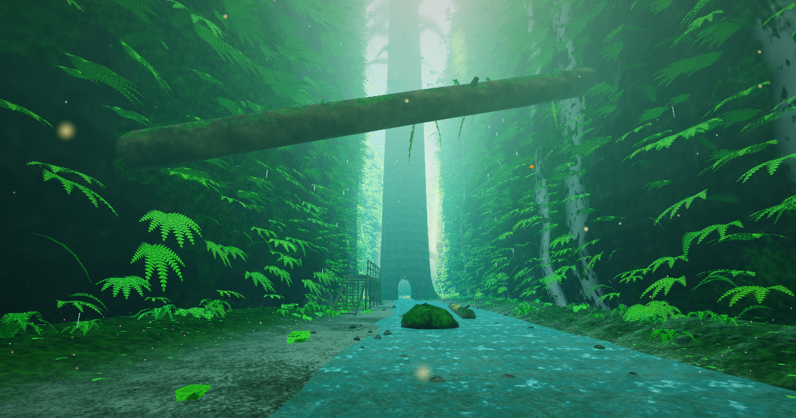

# Fern Canyon

A dreamy, endlessly looping 3D/VR walk through Fern Canyon in Prairie Creek Redwoods State Park, Humboldt County, California.

**Play it:** https://solarfren.com/fern-canyon/

Everything is generated by code: the canyon walls, ferns, redwoods, creek, waterfalls, light shafts and the synthesised ambient sound. It's all in one HTML file using raw WebGL2 and WebXR, with no libraries, images, models or audio files.

## Features

- A 700 m canyon that loops back on itself, so the walk never ends
- Three themed stretches: The Narrows, The Cathedral (with a walk-through "mother tree") and Amethyst Hollow
- Jump onto drift logs, boulders, boardwalks, footbridges, stairs and hollow logs
- Hidden grottos and about two dozen collectible lights; find them all for a secret dusk
- A new random layout every load (or a fixed one with `#seed=N`)
- Guided walk mode, Low/Medium/High detail, and VR headset support

## Controls

| Input | Action |
| --- | --- |
| WASD / arrows + mouse | Move and look |
| Space | Jump |
| Shift | Run |
| G | Guided walk |
| M | Sound |
| 1–5 | Viewpoints |
| Touch | Left thumb moves, right thumb looks, Jump button |
| VR | Left stick moves, right stick snap-turns, A/X jumps, trigger toggles guided walk |

## Run locally

Open `index.html` in a browser. VR headsets need it served over HTTPS or localhost, e.g. `python3 -m http.server`.
